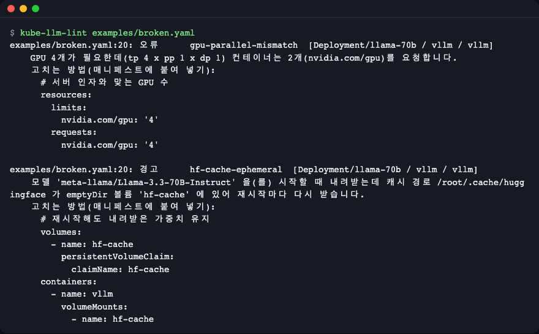
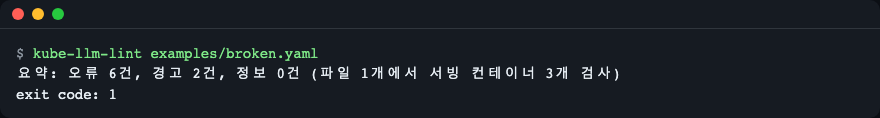
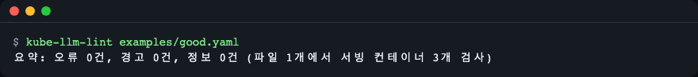
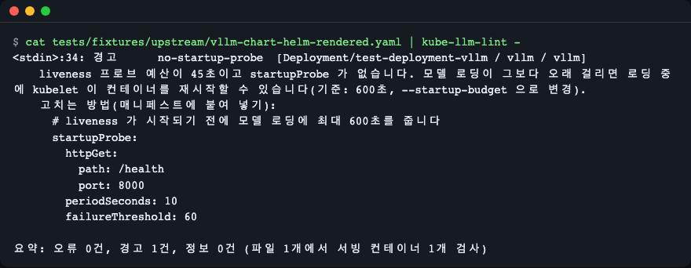
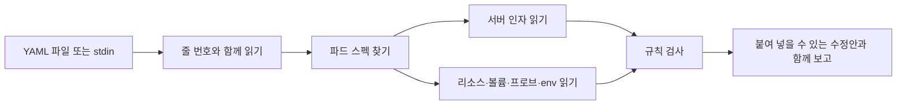

# kube-llm-lint

[English](README.md) | **한국어**

LLM 서빙 엔진(vLLM, SGLang, TGI)의 실행 인자를 쿠버네티스 파드 스펙과 함께 교차 검사하는 오프라인 린터입니다. GPU 노드를 잡고 기다린 뒤에야 드러나는 실수를 미리 찾습니다: GPU 수 불일치, 64 MiB 짜리 `/dev/shm`, 모델을 올리는 도중 파드를 죽이는 프로브, 재시작하면 사라지는 캐시, 평문 Hugging Face 토큰.


*`examples/broken.yaml` 에 `kube-llm-lint` 를 실행한 화면: 각 항목에 파일 줄 번호, 규칙 ID, 이유, 붙여 넣을 YAML 조각이 나옵니다.*

## 이런 분께
- vLLM·SGLang·TGI 를 손으로 쓴 YAML·Helm·kustomize 로 쿠버네티스에 올리면서 `kubectl apply` 전에 실수를 알고 싶은 분.
- 서버 인자와 파드 스펙이 어긋난 매니페스트를 CI 에서 막고 싶은 플랫폼 팀.
- `KeyboardInterrupt: terminated` 재시작 루프, 텐서 병렬에서 NCCL 멈춤, 재시작마다 70B 모델 재다운로드를 겪어서 실행 가능한 점검표가 필요한 분.

## 설치
```bash
# 전제 도구: uv (https://docs.astral.sh/uv/)  ->  curl -LsSf https://astral.sh/uv/install.sh | sh
uv tool install git+https://github.com/LeeGyeongPil/kube-llm-lint
```
Python 3.10 이상이 필요합니다(없으면 uv 가 받아 옵니다). 실행 시 의존성은 `ruamel.yaml` 하나뿐이고, 클러스터·GPU·네트워크 없이 동작합니다.

## 빠르게 시작하기
```bash
git clone https://github.com/LeeGyeongPil/kube-llm-lint && cd kube-llm-lint
kube-llm-lint examples/broken.yaml
```
`examples/broken.yaml` 은 일부러 틀리게 만든 서빙 컨테이너 세 개(vLLM, SGLang, TGI)입니다. 마지막 부분은 이렇습니다.


*오류 6건·경고 2건, 종료 코드 1 이라 CI 작업이 실패합니다.*

항목 하나를 읽는 법(출력은 `--lang en` 으로 실행한 영어 원문이고, 화면 언어는 `--lang ko` 로 바뀝니다).

```text
examples/broken.yaml:20: error   gpu-parallel-mismatch  [Deployment/llama-70b / vllm / vllm]
    GPUs needed: 4 (tp 4 x pp 1 x dp 1), but the container requests 2 (nvidia.com/gpu).
```
- `examples/broken.yaml:20` 은 파일과 컨테이너가 있는 줄입니다.
- `error` 는 심각도, `gpu-parallel-mismatch` 는 규칙 ID, 대괄호는 `종류/이름 / 컨테이너 / 서버` 입니다.
- 다음 줄이 무엇이 문제인지 알려 주고, 이어서 `fix (paste into the manifest)`(한국어로는 `고치는 방법`) 블록이 나옵니다.

고친 버전은 통과합니다.


*`examples/good.yaml` 은 같은 서버 세 개의 문제를 고친 것입니다: 지적 없음, 종료 코드 0.*

## 사용법
| 명령·옵션 | 하는 일 | 예 |
|---|---|---|
| `PATH ...` | 파일, 디렉터리(`*.yaml`·`*.yml` 을 재귀 탐색), 표준 입력은 `-` | `kube-llm-lint deploy/` |
| `--format text\|json\|sarif` | 읽기 쉬운 보고서(기본), JSON 또는 SARIF 2.1.0 | `--format sarif` |
| `--fail-on error\|warning\|info\|none` | 종료 코드를 1 로 만드는 가장 낮은 심각도(기본 `error`) | `--fail-on warning` |
| `--startup-budget SECONDS` | 컨테이너가 정상이 되기까지 허용하는 시간(기본 600) | `--startup-budget 1200` |
| `--disable RULES` | 끌 규칙 ID 를 쉼표로 | `--disable shm-missing,gpu-missing` |
| `--list-rules` | 모든 규칙과 심각도·출처 URL·확인 날짜 출력 | `kube-llm-lint --list-rules` |
| `--lang en\|ko` | 출력 언어 | `--lang ko` |
| `--version` | 버전 출력 | `kube-llm-lint --version` |

종료 코드: `0` 이상 없음, `1` `--fail-on` 이상의 지적 있음, `2` 사용법·입력 오류(없는 파일, YAML 문법 오류).

### Helm 차트 검사
```bash
helm template my-release ./chart | kube-llm-lint - --fail-on warning
```
렌더링 결과를 표준 입력(`-`)으로 읽으므로 클러스터가 실제로 받는 내용을 검사합니다. 아래 화면은 실제 `helm template` 출력 대신 vLLM 예제 차트 기본값을 손으로 렌더링한 테스트 픽스처를 넘긴 것입니다: `cat tests/fixtures/upstream/vllm-chart-helm-rendered.yaml | kube-llm-lint -`.


*liveness 예산 45초에 `startupProbe` 가 없어서 경고 1건, 600초를 허용하는 프로브 조각이 함께 나옵니다.*

### CI 에서 쓰기
```yaml
- run: uv tool install git+https://github.com/LeeGyeongPil/kube-llm-lint
- run: kube-llm-lint manifests/ --fail-on warning
```

### 기계가 읽는 출력
```bash
kube-llm-lint examples/broken.yaml --format json --fail-on warning
```
`{"findings": [...], "summary": {"errors": 6, "warnings": 2, "info": 0, "containers": 3, "files": 1}}` 를 출력합니다. 각 항목은 `file`, `line`, `kind`, `name`, `namespace`, `container`, `server`, `rule`, `severity`, `message`, `fix` 를 가집니다.

### code scanning 에 올리기 (SARIF)
```bash
kube-llm-lint manifests/ --format sarif --fail-on none > kube-llm-lint.sarif
```
만들어진 `kube-llm-lint.sarif` 를 GitHub 의 `github/codeql-action/upload-sarif` 단계로 올리면 지적이 줄 단위 주석으로 보입니다.

그대로 쓸 수 있는 워크플로 전체 예입니다. 예를 들어 `.github/workflows/kube-llm-lint.yml` 로 저장하고 `manifests/` 를 내 폴더로 바꾸세요.

```yaml
name: kube-llm-lint
on: [push, pull_request]
jobs:
  lint:
    runs-on: ubuntu-latest
    permissions:
      contents: read
      security-events: write   # upload-sarif 에 필요
    steps:
      - uses: actions/checkout@v4
      - uses: astral-sh/setup-uv@v10.3.3
      - run: uv tool install git+https://github.com/LeeGyeongPil/kube-llm-lint
      # --fail-on none 이면 종료 코드가 0 이라, 지적이 있어도 업로드 단계가 실행됩니다
      - run: kube-llm-lint manifests/ --format sarif --fail-on none > kube-llm-lint.sarif
      - uses: github/codeql-action/upload-sarif@v4
        with:
          sarif_file: kube-llm-lint.sarif
```
지적은 레포의 Security 탭과 PR 의 줄 단위 주석으로 보입니다. 공개 레포는 따로 할 일이 없고, 비공개 레포는 code scanning(GitHub Code Security)을 켜야 업로드가 받아들여집니다.

### 워크로드 하나에서 규칙 하나 끄기
```yaml
metadata:
  name: mistral-7b
  annotations:
    kube-llm-lint/ignore: no-startup-probe   # 쉼표로 구분한 규칙 ID
```

### 규칙
`kube-llm-lint --list-rules` 는 13개 전부를 출처와 함께 보여 줍니다.

| 규칙 | 심각도 | 잡는 것 |
|---|---|---|
| `gpu-parallel-mismatch` | error | 텐서×파이프라인×데이터 병렬 크기가 뜻하는 GPU 수와 요청한 GPU 수가 다름 |
| `gpu-missing` | warning | 서빙 컨테이너에 GPU 리소스가 없음 |
| `gpu-mig-unchecked` | info | MIG 리소스는 병렬 크기와 비교하지 않음 |
| `shm-missing` | error | GPU 가 둘 이상인데 `/dev/shm` 에 마운트가 없음(기본 64 MiB) |
| `shm-not-memory` | warning | `/dev/shm` 볼륨이 `medium: Memory` 인 `emptyDir` 이 아님 |
| `shm-too-small` | warning | `/dev/shm` 볼륨이 1Gi 미만 |
| `no-startup-probe` | warning | liveness 프로브만 있고 `startupProbe` 가 없어 시작 예산보다 짧음 |
| `probe-budget-short` | warning | `startupProbe` 예산이 시작 예산보다 짧음 |
| `hf-cache-ephemeral` | warning | 시작 때 모델을 내려받는데 캐시가 `emptyDir` 이거나 마운트가 없음 |
| `hf-token-plaintext` | error | `HF_TOKEN` 을 `secretKeyRef` 대신 리터럴 값으로 설정 |
| `mem-fraction-range` | error | GPU 메모리 비율이 (0, 1] 밖 |
| `config-file-unchecked` | info | vLLM `--config` 파일 안의 값은 읽지 않음 |
| `arg-unresolved` | info | 변수 값을 풀지 못해 그 값이 필요한 검사를 건너뜀 |

읽는 워크로드: Pod, Deployment, StatefulSet, DaemonSet, ReplicaSet, Job, CronJob, LeaderWorkerSet.

## 설정
설정 파일은 없습니다. 모든 것은 명령줄 옵션이나 어노테이션입니다(위 참고).

출력 언어는 먼저 맞는 것이 이깁니다: `--lang`, `KUBE_LLM_LINT_LANG`, `LC_ALL`, `LC_MESSAGES`, `LANG` 순이며, 값이 `ko` 로 시작하지 않으면 영어입니다.
```bash
KUBE_LLM_LINT_LANG=ko kube-llm-lint examples/good.yaml
# 요약: 오류 0건, 경고 0건, 정보 0건 (파일 1개에서 서빙 컨테이너 3개 검사)
```

## 동작 원리

1. 로더가 줄 번호를 유지해서, 지적이 파일 전체가 아니라 컨테이너를 가리킵니다.
2. 워크로드 종류마다 파드 스펙의 위치를 찾습니다.
3. 컨테이너마다 서버(`vllm serve`, `sglang.launch_server`, `text-generation-launcher`, 없으면 이미지 이름)를 알아낸 뒤 `command`·`args`(`sh -c` 문자열, `env` 의 리터럴 값으로 채우는 `$(VAR)`·`$VAR` 포함)에서 인자를 읽습니다.
4. 규칙이 그 인자를 파드 스펙과 비교합니다. 프로브 예산은 `initialDelaySeconds + periodSeconds x failureThreshold` 입니다. YAML `null` 이거나 값 없이 키만 있으면 Kubernetes 기본값(0, 10, 3)을 쓰고, 빈 문자열 `""` 이나 숫자가 아닌 값은 `arg-unresolved` 로 알립니다.
5. 풀 수 없는 값(예: ConfigMap 에서 오는 값)은 추측하지 않고 `arg-unresolved` 정보를 내며 그 값이 필요한 검사는 건너뜁니다.
6. 보고서는 토큰 값을 절대 출력하지 않고 `hf_****` 만 보여 줍니다.

프로브 예산 계산 예: 쿠버네티스 문서 예제의 `startupProbe` 가 `failureThreshold: 3`, `periodSeconds: 10`, `initialDelaySeconds: 60` 이면 60 + 10 x 3 = 90초입니다. 모델 로딩이 이보다 오래 걸리면 kubelet 이 컨테이너를 재시작하며, 이 예산이 `--startup-budget`(기본 600초)보다 작으면 경고합니다.

## 따로 린터가 필요한 이유
범용 린터는 서버 인자의 의미를 모릅니다. 2026-11-16 에 LLM 서빙 실수 8가지(GPU 수와 텐서 병렬 크기, 없거나 작은 `/dev/shm`, `startupProbe` 예산 부족, 임시 모델 캐시, 평문 `HF_TOKEN` 등)가 든 매니페스트에 kube-linter v0.8.3 을 돌렸습니다.

```bash
kube-linter lint bad.yaml                      # 기본 검사: 8건 중 0건
kube-linter lint --add-all-built-in bad.yaml   # 내장 63개 전부: 여전히 8건 중 0건
```
`env-var-secret` 도 평문 `HF_TOKEN` 을 잡지 못했습니다. 이름 패턴이 secret/password 계열이기 때문입니다. `kube-llm-lint` 는 인자(`--tensor-parallel-size`, `--shm-size` 등)를 읽어 파드 스펙과 비교하는데, 범용 검사로는 할 수 없는 일입니다. [kube-linter](https://github.com/stackrox/kube-linter), [Polaris](https://github.com/FairwindsOps/polaris), [kubeconform](https://github.com/yannh/kubeconform) 을 대체하지 않고 보완합니다.

## 언제 쓰나
- 잘 맞는 경우: vLLM·SGLang·TGI 인자와 파드 스펙의 관계를 로컬이나 CI 에서 빠르게, 오프라인으로 확인하고 싶을 때.
- 범용 린터를 대신하지 않습니다. 일반 보안·모범 사례 검사는 [kube-linter](https://github.com/stackrox/kube-linter)나 [Polaris](https://github.com/FairwindsOps/polaris), 스키마 검증은 [kubeconform](https://github.com/yannh/kubeconform) 을 쓰세요. 이 도구와 함께 돌릴 수 있습니다.
- 매니페스트만 읽습니다. 클러스터와 통신하지 않으므로 실제 GPU 종류, 노드 메모리, 모델 크기는 알 수 없습니다.

## 한계
- 정적 분석뿐입니다. 클러스터와 통신하지 않으므로 실제 GPU 종류, 노드 메모리, 모델 크기는 알 수 없습니다.
- vLLM `--config` 파일 내용, ConfigMap 에서 오는 값, 직접 만든 시작 스크립트는 읽지 않습니다. 컨테이너 `command` 가 알려진 서버가 아닌 것을 실행하면 GPU·shm 검사는 추측하지 않고 건너뜁니다.
- 기본 시작 예산 600초는 출발점입니다. 실제 로딩 시간은 모델·디스크·네트워크에 따라 다르니 `--startup-budget` 으로 조정하세요.
- 단일 파드 스펙이 범위입니다. 다중 노드 구성(LeaderWorkerSet, 오퍼레이터 CRD)은 전체가 아니라 컨테이너별로 읽습니다.
- 서버 플래그 이름과 기본값은 버전마다 바뀝니다. 플래그 표는 2026-11-16 에 확인했습니다(`--list-rules` 참고).

## 로드맵
약속이 아닌 아이디어: 바로 쓰는 GitHub Action, pre-commit 훅, KServe `InferenceService` 지원.

## 자주 겪는 문제
| 증상 | 원인 | 해결 |
|---|---|---|
| `error: cannot read ...: no such file or directory`(종료 2) | 경로 오류 | 경로를 확인하세요. 디렉터리는 `*.yaml`·`*.yml` 만 탐색합니다 |
| `error: ...: YAML parse error`(종료 2) | 잘못된 YAML, 렌더링하지 않은 Helm 템플릿인 경우가 많음 | `helm template` 을 먼저 실행해 `-` 로 넘기세요 |
| `arg-unresolved` 정보가 나오고 GPU·shm 검사가 빠짐 | 값이 `env` 에 리터럴로 없는 변수에서 옴 | 값을 직접 적거나, 그 검사가 건너뛰어지는 것을 받아들이세요 |
| 경고가 나왔는데 종료 코드가 0 | `--fail-on` 기본값이 `error` | CI 에서는 `--fail-on warning` 을 쓰세요 |
| 몇 초면 뜨는 모델에 `no-startup-probe` | 기본 예산이 600초 | `--startup-budget 60` 을 주거나 ignore 어노테이션을 쓰세요 |
| 한국어 시스템에서 출력이 한국어 | 언어가 `LANG` 을 따름 | `--lang en` 또는 `KUBE_LLM_LINT_LANG=en` |

## 개발·기여
```bash
uv sync
uv run pytest -q
```
테스트는 오프라인에서 1초 안팎에 끝납니다. 버그·제안은 이슈로 남겨 주세요. 변경 기록은 [CHANGELOG.md](CHANGELOG.md).

## 라이선스
MIT. `tests/fixtures/upstream/` 의 테스트 픽스처는 vLLM 프로젝트(Apache License 2.0)에서 가져온 것이며 [NOTICE](NOTICE) 를 참고하세요.

## 출처
규칙 출처(2026-11-16 확인): [vLLM 쿠버네티스 배포](https://docs.vllm.ai/en/latest/deployment/k8s/), [vLLM 엔진 인자](https://docs.vllm.ai/en/latest/configuration/engine_args/), [vLLM 이슈 17386](https://github.com/vllm-project/vllm/issues/17386), [TGI 공유 메모리 안내](https://github.com/huggingface/text-generation-inference#a-note-on-shared-memory-shm), [쿠버네티스 프로브](https://kubernetes.io/docs/tasks/configure-pod-container/configure-liveness-readiness-startup-probes/), [SGLang](https://github.com/sgl-project/sglang).
