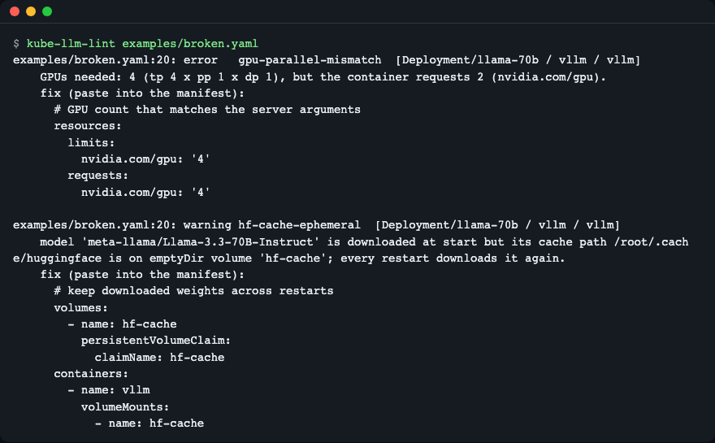
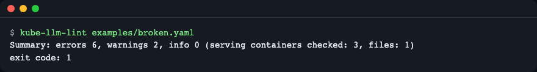
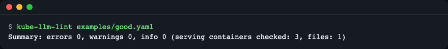
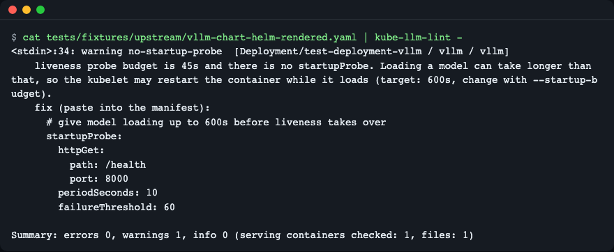
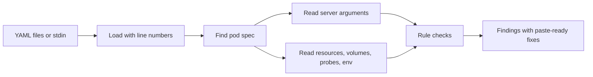

# kube-llm-lint

**English** | [한국어](README.ko.md)

Offline linter that cross-checks the arguments of an LLM serving engine (vLLM, SGLang, TGI) against the Kubernetes pod spec around it. It finds the mistakes that only show up after you have waited for a GPU node: wrong GPU count, a 64 MiB `/dev/shm`, a probe that kills the pod while the model loads, a cache that vanishes on restart, a plaintext Hugging Face token.


*Running `kube-llm-lint` on `examples/broken.yaml`: each finding has a file line, a rule id, the reason, and a YAML snippet to paste.*

## Who it is for
- You deploy vLLM, SGLang or TGI to Kubernetes with hand-written YAML, Helm or kustomize and want to know about mistakes before `kubectl apply`.
- You run a platform team and want a CI step that rejects manifests where the server arguments and the pod spec disagree.
- You got `KeyboardInterrupt: terminated` restart loops, NCCL hangs with tensor parallelism, or a 70B model re-downloaded after every restart, and want a checklist that is executable.

## Install
```bash
# prerequisite: uv (https://docs.astral.sh/uv/)  ->  curl -LsSf https://astral.sh/uv/install.sh | sh
uv tool install git+https://github.com/LeeGyeongPil/kube-llm-lint
```
Requires Python 3.10 or newer (uv fetches one if needed). The only runtime dependency is `ruamel.yaml`. No cluster, GPU or network is needed to run it.

## Quick start
```bash
git clone https://github.com/LeeGyeongPil/kube-llm-lint && cd kube-llm-lint
kube-llm-lint examples/broken.yaml
```
`examples/broken.yaml` holds three deliberately broken serving containers (vLLM, SGLang, TGI). The last lines are:


*Six errors and two warnings; exit code 1 so a CI job fails.*

Reading one finding:

```text
examples/broken.yaml:20: error   gpu-parallel-mismatch  [Deployment/llama-70b / vllm / vllm]
    GPUs needed: 4 (tp 4 x pp 1 x dp 1), but the container requests 2 (nvidia.com/gpu).
```
- `examples/broken.yaml:20` is the file and the line of the container.
- `error` is the severity, `gpu-parallel-mismatch` the rule id, the bracket is `kind/name / container / server`.
- The next line says what is wrong, then a `fix (paste into the manifest)` block follows.

The fixed version passes:


*`examples/good.yaml` is the same three servers with the problems fixed: no findings, exit code 0.*

## Usage
| Command / option | What it does | Example |
|---|---|---|
| `PATH ...` | Files, directories (searched recursively for `*.yaml`/`*.yml`) or `-` for stdin | `kube-llm-lint deploy/` |
| `--format text\|json` | Human-readable report (default) or JSON | `--format json` |
| `--fail-on error\|warning\|info\|none` | Lowest severity that makes the exit code 1 (default `error`) | `--fail-on warning` |
| `--startup-budget SECONDS` | Time a container may take to become healthy (default 600) | `--startup-budget 1200` |
| `--disable RULES` | Comma-separated rule ids to turn off | `--disable shm-missing,gpu-missing` |
| `--list-rules` | Print every rule with severity, source URL and the date it was checked | `kube-llm-lint --list-rules` |
| `--lang en\|ko` | Output language | `--lang ko` |
| `--version` | Print the version | `kube-llm-lint --version` |

Exit codes: `0` clean, `1` findings at or above `--fail-on`, `2` usage or input error (missing file, YAML syntax error).

### Check a Helm chart
```bash
helm template my-release ./chart | kube-llm-lint - --fail-on warning
```
Rendered output is read from stdin (`-`), so the check sees what the cluster will see. The screenshot below pipes a hand-rendered copy of the vLLM example chart's default values (a test fixture) in place of real `helm template` output: `cat tests/fixtures/upstream/vllm-chart-helm-rendered.yaml | kube-llm-lint -`.


*A liveness budget of 45 s and no `startupProbe`: one warning, with a probe snippet that allows 600 s.*

### Use it in CI
```yaml
- run: uv tool install git+https://github.com/LeeGyeongPil/kube-llm-lint
- run: kube-llm-lint manifests/ --fail-on warning
```

### Machine-readable output
```bash
kube-llm-lint examples/broken.yaml --format json --fail-on warning
```
Prints `{"findings": [...], "summary": {"errors": 6, "warnings": 2, "info": 0, "containers": 3, "files": 1}}`; each finding has `file`, `line`, `kind`, `name`, `namespace`, `container`, `server`, `rule`, `severity`, `message` and `fix`.

### Silence one rule on one workload
```yaml
metadata:
  name: mistral-7b
  annotations:
    kube-llm-lint/ignore: no-startup-probe   # comma-separated rule ids
```

### The rules
`kube-llm-lint --list-rules` prints all 13 with their sources.

| Rule | Severity | Catches |
|---|---|---|
| `gpu-parallel-mismatch` | error | GPUs implied by tensor x pipeline x data parallel size differ from the GPUs requested |
| `gpu-missing` | warning | A serving container with no GPU resource |
| `gpu-mig-unchecked` | info | MIG resources are not compared with parallel sizes |
| `shm-missing` | error | More than one GPU but nothing mounted at `/dev/shm` (64 MiB default) |
| `shm-not-memory` | warning | `/dev/shm` volume is not `emptyDir` with `medium: Memory` |
| `shm-too-small` | warning | `/dev/shm` volume under 1Gi |
| `no-startup-probe` | warning | A liveness probe without `startupProbe`, shorter than the startup budget |
| `probe-budget-short` | warning | `startupProbe` budget shorter than the startup budget |
| `hf-cache-ephemeral` | warning | Model downloaded at start, cache on `emptyDir` or no mount |
| `hf-token-plaintext` | error | `HF_TOKEN` set as a literal value instead of `secretKeyRef` |
| `mem-fraction-range` | error | GPU memory fraction outside (0, 1] |
| `config-file-unchecked` | info | Values inside a vLLM `--config` file are not read |
| `arg-unresolved` | info | A variable could not be resolved, dependent checks skipped |

Workloads read: Pod, Deployment, StatefulSet, DaemonSet, ReplicaSet, Job, CronJob, LeaderWorkerSet.

## Configuration
There is no config file. Everything is a command-line option or an annotation (see above).

Output language, first match wins: `--lang`, then `KUBE_LLM_LINT_LANG`, then `LC_ALL`, `LC_MESSAGES`, `LANG`; English unless the value starts with `ko`.
```bash
KUBE_LLM_LINT_LANG=ko kube-llm-lint examples/good.yaml
# 요약: 오류 0건, 경고 0건, 정보 0건 (파일 1개에서 서빙 컨테이너 3개 검사)
```

## How it works

1. The loader keeps line numbers so a finding points at the container, not just the file.
2. It finds the pod spec inside each workload kind.
3. For each container it recognises the server (`vllm serve`, `sglang.launch_server`, `text-generation-launcher`, or the image name), then reads its arguments from `command` and `args`, including `sh -c` strings and `$(VAR)` or `$VAR` taken from literal `env` values.
4. Rules compare those arguments with the pod spec. The probe budget is `initialDelaySeconds + periodSeconds x failureThreshold`. A YAML `null` or valueless probe field (key with no value) uses the Kubernetes default (0, 10, 3); an empty string `""` or a non-numeric value is reported as `arg-unresolved`.
5. Values that cannot be resolved (for example from a ConfigMap) produce an `arg-unresolved` info and the checks that need them are skipped rather than guessed.
6. The report never prints a token value, only `hf_****`.

Worked probe budget: the Kubernetes docs example `startupProbe` with `failureThreshold: 3`, `periodSeconds: 10` and `initialDelaySeconds: 60` gives 60 + 10 x 3 = 90 s. If the model needs longer to load, the kubelet restarts the container; the linter warns when this budget is below `--startup-budget` (600 s by default).

## Why a separate linter
General-purpose linters do not know what the server arguments mean. On 2026-11-16 we ran kube-linter v0.8.3 against a manifest containing eight LLM-serving mistakes (GPU count vs tensor parallel size, missing or tiny `/dev/shm`, no `startupProbe` budget, ephemeral model cache, plaintext `HF_TOKEN`, and similar):

```bash
kube-linter lint bad.yaml                      # default checks: 0 of the 8 found
kube-linter lint --add-all-built-in bad.yaml   # all 63 built-in checks: still 0 of the 8
```
Even `env-var-secret` did not flag the plaintext `HF_TOKEN`, because it matches secret/password-style names. `kube-llm-lint` reads the arguments (`--tensor-parallel-size`, `--shm-size`, ...) and compares them with the pod spec, which a generic check cannot do. It complements [kube-linter](https://github.com/stackrox/kube-linter), [Polaris](https://github.com/FairwindsOps/polaris) and [kubeconform](https://github.com/yannh/kubeconform); it does not replace them.

## When to use it
- Good fit: you want a fast, offline check of the relationships between vLLM, SGLang or TGI arguments and the pod spec, locally or in CI.
- It does not replace general linters. For generic security and best-practice checks use [kube-linter](https://github.com/stackrox/kube-linter) or [Polaris](https://github.com/FairwindsOps/polaris); for schema validation use [kubeconform](https://github.com/yannh/kubeconform). They can run alongside this tool.
- It only reads manifests. It does not talk to a cluster, so it cannot know the real GPU type, node memory or model size.

## Limitations
- Static analysis only: it never contacts a cluster, so real GPU type, node memory and model size are unknown.
- It does not read the contents of a vLLM `--config` file, values that come from ConfigMaps, or custom start scripts. When a container's `command` runs something other than a known server, the GPU and shm checks are skipped rather than guessed.
- The 600 s default startup budget is a starting point. Real load time depends on the model, disk and network; tune it with `--startup-budget`.
- Scope is single-pod specs. Multi-node setups (LeaderWorkerSet, operator CRDs) are read per container, not as a whole.
- Server flag names and defaults change between versions. The flag tables were checked on 2026-11-16 (see `--list-rules`).

## Roadmap
Ideas, not promises: SARIF output, a ready-made GitHub Action, a pre-commit hook, KServe `InferenceService` support.

## Troubleshooting
| Symptom | Cause | Fix |
|---|---|---|
| `error: cannot read ...: no such file or directory` (exit 2) | Wrong path | Check the path; directories are searched for `*.yaml` and `*.yml` only |
| `error: ...: YAML parse error` (exit 2) | Invalid YAML, often unrendered Helm templates | Run `helm template` first and pipe it in with `-` |
| `arg-unresolved` info and a GPU or shm check is missing | The value comes from a variable that has no literal value in `env` | Write the value inline, or accept that this check is skipped |
| Exit code 0 although a warning is printed | `--fail-on` defaults to `error` | Use `--fail-on warning` in CI |
| `no-startup-probe` for a model that loads in seconds | Default budget is 600 s | Pass `--startup-budget 60` or add the ignore annotation |
| Output is Korean on a Korean system | The language follows `LANG` | Pass `--lang en` or set `KUBE_LLM_LINT_LANG=en` |

## Development
```bash
uv sync
uv run pytest -q
```
The tests run offline in about a second. Bug reports and ideas are welcome as issues. Changes are listed in [CHANGELOG.md](CHANGELOG.md).

## License
MIT. Test fixtures under `tests/fixtures/upstream/` are derived from the vLLM project (Apache License 2.0), see [NOTICE](NOTICE).

## Sources
Rule sources (checked 2026-11-16): [vLLM Kubernetes deployment](https://docs.vllm.ai/en/latest/deployment/k8s/), [vLLM engine arguments](https://docs.vllm.ai/en/latest/configuration/engine_args/), [vLLM issue 17386](https://github.com/vllm-project/vllm/issues/17386), [TGI note on shared memory](https://github.com/huggingface/text-generation-inference#a-note-on-shared-memory-shm), [Kubernetes probes](https://kubernetes.io/docs/tasks/configure-pod-container/configure-liveness-readiness-startup-probes/), [SGLang](https://github.com/sgl-project/sglang).
